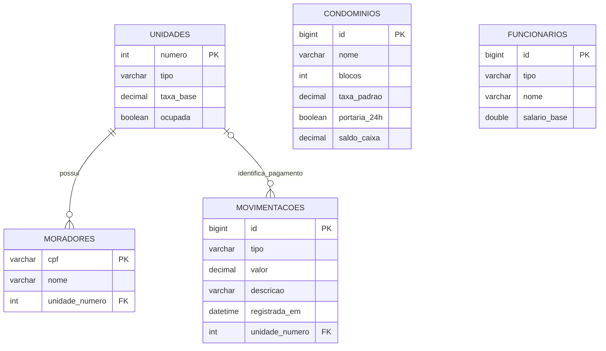

# Entendendo o banco de dados

## O que é H2?

H2 é um banco relacional escrito em Java. Ele guarda tabelas, colunas, chaves e relacionamentos e permite consultas SQL. Não é um arquivo de texto simulando um banco.

Neste projeto, o H2 funciona **embutido**: o próprio programa Java abre o banco dentro do seu processo. Por isso não precisamos instalar um servidor separado. Os dados ficam em `dados/condominio.mv.db` e continuam existindo após fechar o sistema.

Os testes também usam H2 em memória (`jdbc:h2:mem:...`), que desaparece ao fechar as conexões, e em arquivos temporários, para verificar a reabertura. A execução normal usa arquivo; não perde os pagamentos ao sair.

## Como ele difere do MySQL?

| Aspecto | H2 da demonstração | MySQL |
|---|---|---|
| Onde executa | Dentro da aplicação Java | Em um servidor separado |
| Instalação para apresentar | Nenhuma além de Java; os pacotes nativos já incluem Java | Exige servidor disponível |
| Dados | Arquivo `.mv.db` | Armazenados e administrados pelo servidor |
| Ferramenta de consulta | Console H2 ou IDE compatível | Workbench ou outro cliente MySQL |
| Compartilhamento | Copiar banco fechado ou exportar SQL H2 | Exportar e restaurar dump MySQL |

Não há sincronização entre os dois. Um pagamento feito no H2 não aparece no MySQL quando se troca a configuração.

## A conexão em passos

1. `App.main` chama `Banco.abrirPadrao()`.
2. `Banco` lê a propriedade Java `banco`, depois a variável `BANCO`. Se nenhuma estiver definida, escolhe H2.
3. Lê URL, usuário e senha pelas propriedades `db.url`, `db.user`, `db.password` ou pelas variáveis `DB_URL`, `DB_USER`, `DB_PASSWORD`.
4. Informa essas configurações a `Persistence.createEntityManagerFactory("condominio", propriedades)`.
5. A unidade `condominio`, no `META-INF/persistence.xml`, lista as entidades e o provedor Hibernate.
6. Hibernate utiliza o driver JDBC correspondente para se comunicar com o banco.
7. A fábrica cria um `EntityManager` por operação. O programa fecha cada um após a consulta ou transação e fecha a fábrica ao sair.

Uma URL JDBC informa ao driver qual banco abrir:

```text
jdbc:h2:./dados/condominio
│    │  └─ caminho do arquivo; o H2 acrescenta .mv.db
│    └──── tipo de banco
└───────── conexão por JDBC

jdbc:mysql://localhost:3306/gestao_condominio
             │         │    └─ nome da base
             │         └────── porta do servidor
             └──────────────── computador do servidor
```

No H2 do projeto, o usuário é `sa` e a senha é vazia, somente para os dados fictícios da demonstração. No MySQL, use o usuário e a senha locais do servidor; a senha não deve ser colocada no código nem publicada no GitHub.

## JDBC, JPA e Hibernate são a mesma coisa?

Não. **JDBC** é a API de comunicação com o banco e o driver implementa a comunicação para cada produto. **JPA** é a especificação que descreve a persistência de objetos. **Hibernate** implementa JPA e transforma as operações com entidades em comandos SQL.

O repositório usa consultas JPQL, por exemplo `select u from Unidade u`. O nome se refere à classe Java, e Hibernate monta o SQL para a tabela `unidades`. Nos scripts e no Workbench, usamos SQL diretamente, por exemplo `SELECT * FROM unidades`.

## Estrutura das tabelas



`CONDOMINIOS` guarda o caixa de um condomínio único. Por simplificação da v1, as unidades não têm uma chave para selecionar diferentes condomínios. `FUNCIONARIOS` também é uma tabela independente neste escopo. Uma aplicação para vários condomínios precisaria relacionar esses registros.

Cobertura e unidade comum ficam na mesma tabela; `tipo` informa a classe a reconstruir. O mesmo vale para funcionário e zelador. Uma despesa não possui unidade; um pagamento possui.

## Onde estão os scripts de criação?

- `sql/mysql.sql`: script legível com criação das tabelas, chaves estrangeiras e dados demonstrativos para MySQL.
- `sql/backup-h2.sql`: incluído nos ZIPs gerados; exportação SQL das tabelas e registros do banco H2 distribuído.
- `persistence.xml` e anotações das entidades: definem o mapeamento. Com `hibernate.hbm2ddl.auto=update`, o Hibernate cria/ajusta as tabelas ao abrir a aplicação. Essa é uma simplificação didática, não um substituto de migrações em produção.

O script MySQL e o backup H2 pertencem a produtos diferentes. Não execute o backup H2 no Workbench.

## Pagamento, commit e rollback

O serviço abre a transação, bloqueia o registro do caixa, calcula a taxa, altera o objeto condomínio e cria o lançamento. Só então faz **commit**, confirmando as duas gravações juntas.

Se houver erro antes do commit, o **rollback** descarta as mudanças. Isso evita ter saldo sem histórico ou histórico sem saldo. O bloqueio de escrita evita que duas operações leiam o mesmo saldo e uma apague o efeito da outra.

## Mostrar as tabelas no navegador

Feche a TUI. Na pasta do código compilado, execute:

```sh
java -cp target/gestao-condominio.jar org.h2.tools.Server -web -webPort 8082 -properties null -ifExists
```

No ZIP completo, remova `target/` do caminho do JAR. Mantenha esse terminal aberto e acesse `http://localhost:8082`. Driver `org.h2.Driver`, URL `jdbc:h2:./dados/condominio;IFEXISTS=TRUE`, usuário `sa`, senha vazia. `IFEXISTS` evita criar um banco vazio por engano.

O console é uma ferramenta de administração, não a interface do projeto. Clique em `+` para ver colunas. Exemplos:

```sql
SELECT * FROM UNIDADES;
SELECT * FROM MORADORES;
SELECT * FROM MOVIMENTACOES ORDER BY ID;
SELECT SALDO_CAIXA FROM CONDOMINIOS;
```

Antes de reabrir a TUI, clique em Disconnect. O banco embutido não pode ser aberto simultaneamente por dois processos separados nesta configuração.
