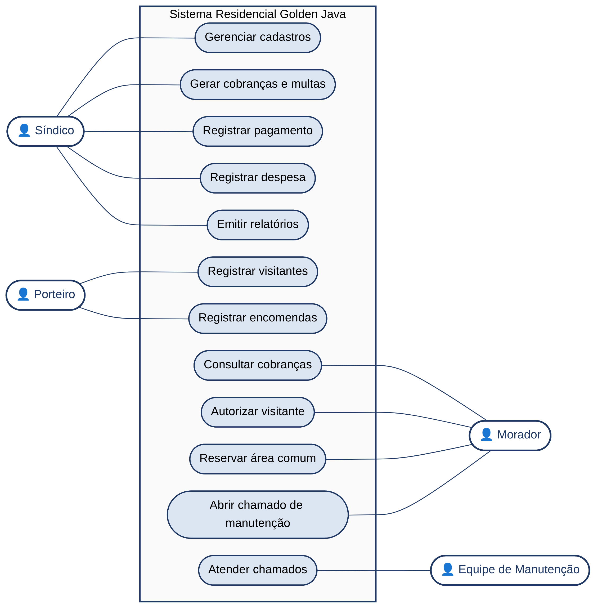
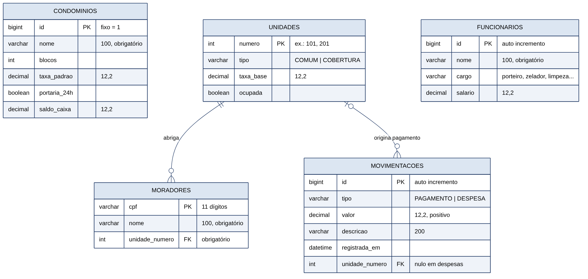

# Entrega do Grupo 02 — documentação e Collections

> Registro histórico dos materiais enviados antes da simplificação do domínio. A aplicação atual está descrita no [README do projeto](../../../README.md); os comentários abaixo sobre v1 e migração pendente retratam aquele momento, não o estado da versão 2.

Materiais recebidos e organizados em **02/11/2026** para consulta do professor. Projeto: **Residencial Golden Java**, de **Kaio Veras e Emanuel Veloso**.

## Acesso direto

| Material | Onde encontrar |
|---|---|
| Documentação entregue pelo grupo | [Projeto_POO_Grupo02.pdf](Projeto_POO_Grupo02.pdf) |
| Orientações fotografadas na aula | [Foto das orientações](orientacoes-professor.jpeg) |
| Programa independente do item 05 | [Collections — App.java](../../../atividades/collections/App.java) |
| Como executar e entender o programa de Collections | [README da atividade](../../../atividades/collections/README.md) |
| Aplicação principal atual | [App.java do sistema](../../../src/main/java/br/edu/catolica/ucb/poo/App.java) |
| Estrutura e execução do sistema | [README do projeto](../../../README.md) |
| Funcionalidades implementadas e pendências | [Estado do projeto](../../estado-do-projeto.md) |
| Downloads da v1 | [Release condominio-v1.0.0](https://github.com/KaioVeras/POO/releases/tag/condominio-v1.0.0) |

## Conferência por item das orientações

| Item na foto | Evidência disponível | Observação |
|---|---|---|
| 00 — Git/Drive e acesso ao material | Este repositório e os links acima | Os materiais estão reunidos para consulta; permissões individuais de edição não foram auditadas nesta organização. |
| 01 — Módulos iniciais, entre 10 e 15 | PDF, página 2 | Proposta com 10 módulos e agrupamentos lógicos. |
| 02 — Personas/perfis | PDF, página 3 | Síndico, morador, porteiro e equipe de manutenção. |
| 03 — Diagrama inicial de casos de uso em PDF | PDF, página 3; [imagem do diagrama](diagramas/casos-de-uso.png) | Representa a proposta geral do sistema. |
| 04 — Modelo de dados | PDF, página 4; [imagem do modelo](diagramas/modelo-de-dados.png) | Núcleo do modelo de dados; o mapeamento implementado também está em [banco-de-dados.md](../../banco-de-dados.md). |
| 04 — Executar/analisar loja-jpa-cl no IntelliJ | Análise registrada no PDF, página 4; [exemplo do professor](../../referencias/loja-jpa-cl.zip) | A foto repete o número 04. O PDF contém notas breves da análise, sem capturas que comprovem execução no IntelliJ. |
| 05 — Programa Java único com ArrayList, HashSet e HashMap | [App.java independente](../../../atividades/collections/App.java) | Complemento ao trecho colocado na página 5 do PDF; não depende de JPA nem de banco. |

Este índice descreve os materiais disponíveis, não atribui nota nem substitui a avaliação do professor.

## Esclarecimento sobre os dois App.java

O texto enviado pelo grupo explicou a dúvida no item 05 e informou o envio de um programa separado com Collections. A organização do repositório mantém essa distinção:

- **App.java da aplicação principal:** inicia a conexão, prepara os dados e abre o menu do sistema completo. Está no pacote `br.edu.catolica.ucb.poo`, em `src/main/java/`.
- **App.java de Collections:** programa isolado, em arquivo único, com `ArrayList`, `HashSet` e `HashMap` no contexto do condomínio. Está em `atividades/collections/` e é o arquivo complementar para o item 05.

O PDF foi preservado **sem alterar o documento já enviado**. Na página 5, o trecho apresentado utiliza `JPAUtil` e não demonstra as três coleções. A versão atual da aplicação principal utiliza `Banco`; portanto, para consultar ou executar o código vigente, siga o link da aplicação principal acima. Para a exigência de Collections, consulte o arquivo independente.

## Proposta geral e implementação atual

O PDF descreve uma proposta mais ampla, com autenticação, permissões, portaria, reservas, manutenção e relatórios. Os perfis e casos de uso representam esse planejamento; não significam que essas funções já estejam disponíveis na v1.

A v1 implementa consultas com dados pré-cadastrados, cálculos de taxas e salários, pagamentos, despesas, histórico e persistência. O programa de Collections é uma atividade complementar: seu exemplo de visitantes não acrescenta um módulo de portaria à aplicação.

Há também uma diferença a acompanhar entre o desenho e o código: o modelo do PDF mostra `cargo` e `salario` decimal em `FUNCIONARIOS`; a v1 utiliza `tipo` para a herança e `salario_base` double. A imagem original foi mantida como proposta entregue. O [script SQL da release v1](https://github.com/KaioVeras/POO/blob/condominio-v1.0.0/gestao-condominio/sql/mysql.sql) corresponde à implementação validada naquela versão.

O GitHub já recebeu um início de alteração para adicionar IDs a unidades e moradores no SQL da branch principal. Essa mudança ainda precisa ser alinhada às entidades Java, às chaves estrangeiras e aos INSERTs. Foi preservada para a próxima etapa; esta organização não executou nem corrigiu a migração.

Os feedbacks posteriores do professor serão tratados em outra etapa. Nesta organização, as regras do sistema principal e a release v1 permanecem preservadas.

## Diagramas

As imagens abaixo foram extraídas das páginas 3 e 4 do PDF fornecido, sem redesenhar ou mudar seu conteúdo. O PDF continua sendo o documento de referência da entrega. Os arquivos-fonte Mermaid desses dois diagramas não foram fornecidos separadamente.

### Casos de uso — proposta inicial

### Modelo de dados — núcleo inicial

